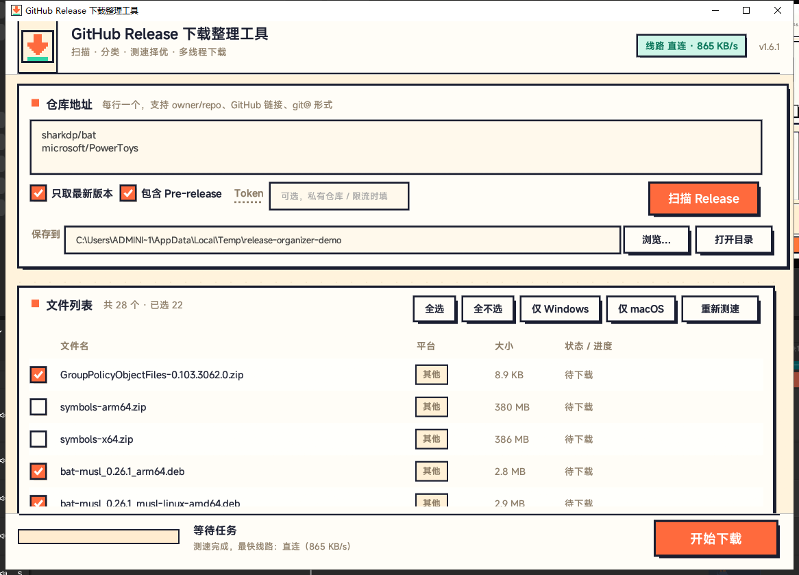
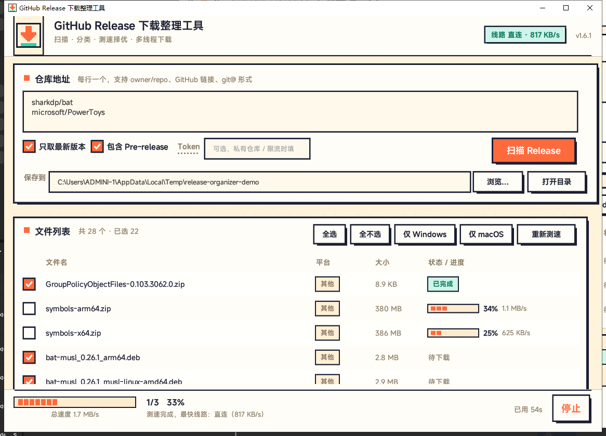
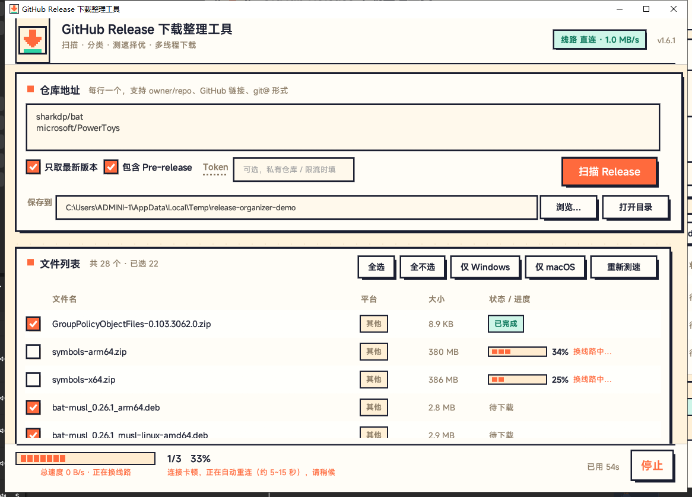
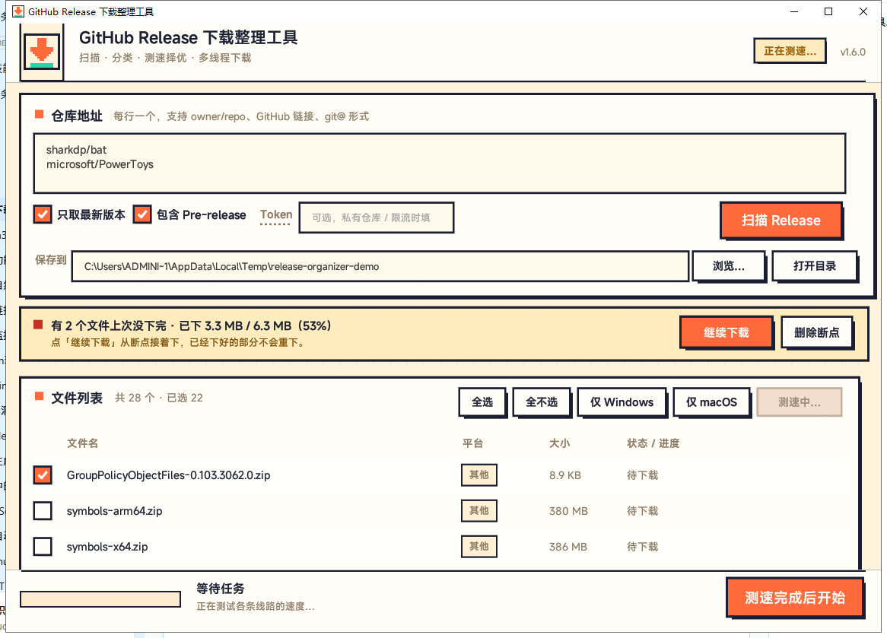
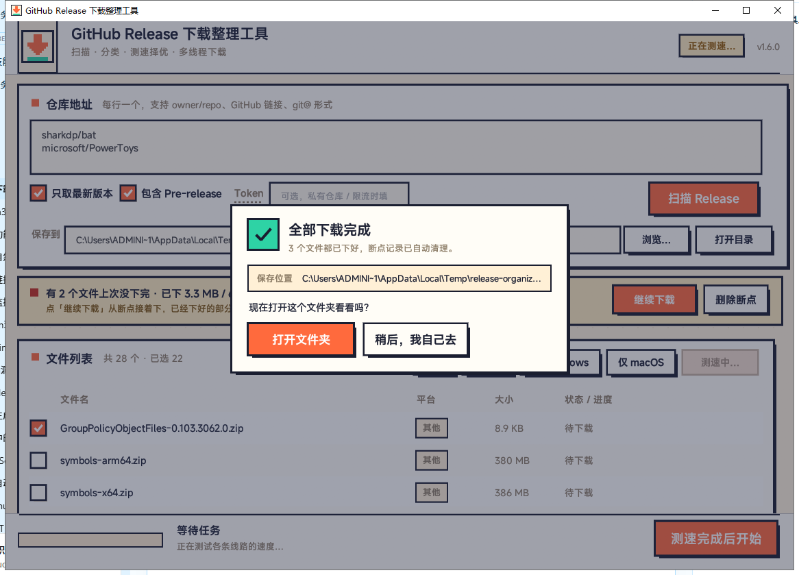
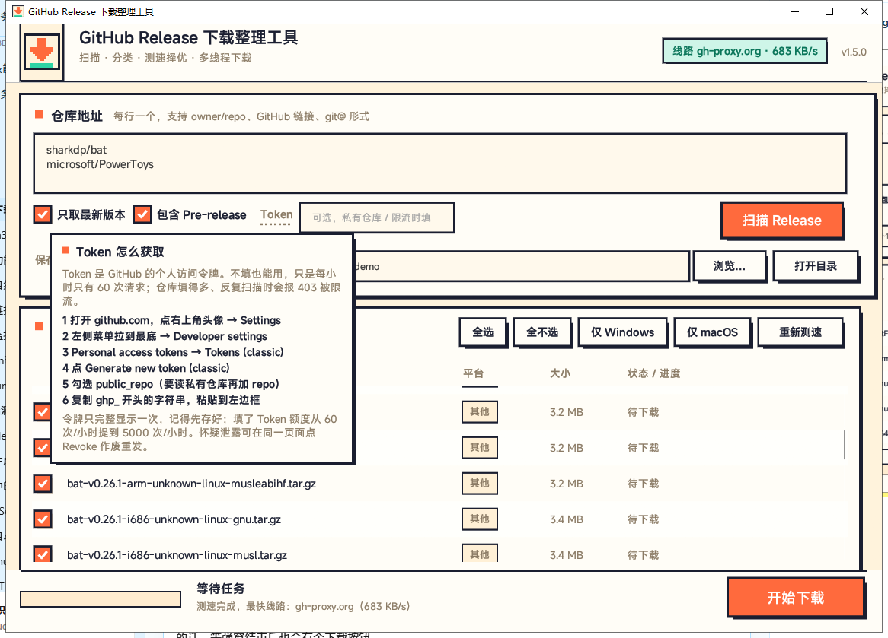
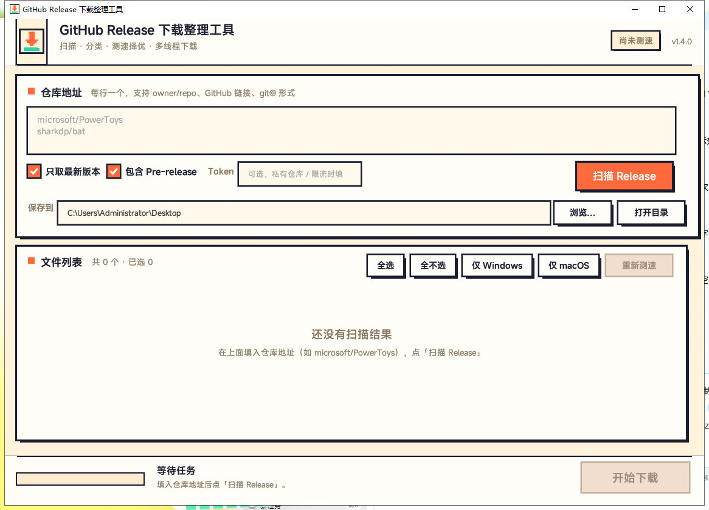

# GitHub 下载整理工具

批量下载多个仓库的 GitHub Release 文件，并按系统与架构自动归档到不同文件夹。免安装单文件 exe，像素风界面，Windows 平台。



## 它解决什么问题

想收集某个软件的全平台安装包，官方 Release 页要一一下载，文件名还混在一起；下几个仓库就更乱。这个工具把「扫描 → 勾选 → 批量下载 → 自动分文件夹」串成一步。

## 功能

- **多仓库批量扫描**：一行一个 `owner/repo`，一次扫完所有仓库的 Release
- **只取最新版**：可过滤掉历史版本，也可手动点选需要的那几个文件
- **自动归档**：按 `仓库/系统/` 建子文件夹，Windows / macOS / Linux 各归各位
- **多连接分片下载**：大文件自动切成 4 / 6 / 8 段并发，失败自动回退单连接
- **卡顿自愈**：10 秒没进展的连接自动断开重连，比同伴慢一大截的分片主动踢掉换线路，
  界面会写明「正在换线路，约 5~15 秒恢复」，不用人工干预
- **断点续传**：中断后分片保留，下次启动在列表上方提示「有 N 个文件没下完」，一键接着下
- **实时总速度**：底部进度条下方显示所有任务加起来的速度，掉到 0 会变红提示
- **镜像线路测速**：内置 8 条线路并行测速，自动挑最快的那条
- **Token 支持**：未登录 GitHub API 每小时限 60 次，填 Token 可提升额度
- **完成提醒**：全部下完后弹窗询问是否直接打开保存文件夹
- **像素风界面**：全部控件手绘，无第三方 UI 库皮肤

## 界面

| 下载中（进度条下是总速度） | 卡顿自动重连时的提示 |
| --- | --- |
|  |  |

| 断点续传提示 | 下载完成提醒 |
| --- | --- |
|  |  |

| 字段悬停说明 | 空状态 |
| --- | --- |
|  |  |

## 使用

1. 从 [Releases](https://github.com/ziyuanhuishequ/release-downloader/releases) 下载最新的 exe（如 `GitHub-Release-Downloader-v1.6.1.exe`），双击运行，无需安装
2. 在仓库框里填入 `owner/repo`，多个用换行分隔
3. 点「扫描 Release」，列表出来后勾选需要的文件
4. 选好保存目录，点「开始下载」

Pre-release 过滤、Token 获取方式等细节，界面上把鼠标停在对应字段约 0.3 秒会浮出说明。

## 编译

环境：Rust stable（建议 1.75+）、Windows 下需要 MSVC 链接器（安装 Visual Studio Build Tools 并勾选「使用 C++ 的桌面开发」）。

```bash
cd rust
cargo build --release
```

产物为 `rust/target/release/release-organizer.exe`，约 4.7 MB。`Cargo.toml` 已配置体积优化（`opt-level="z"` + `lto` + `panic="abort"` + `strip`）。

### 改版本号

四处要同步修改，否则 exe 属性和窗口显示会对不上：

1. `rust/Cargo.toml` → `version`
2. `rust/src/main.rs` → `const APP_VERSION`
3. `rust/src/main.rs` → `const USER_AGENT`
4. `rust/assets/make_icon.py` → `version_blob(ver=...)`，然后 `python rust/assets/make_icon.py` 重新生成图标资源

### 图标资源

`assets/icon.rgba` 在编译期由 `include_bytes!` 编进程序当窗口图标，`assets/icon.res` 由 `build.rs` 链接进 exe 当文件图标，这两个文件必须存在。它们都由 `make_icon.py` 从一张 16×16 字符画生成。

> 注意：界面左上角的图标按 48×48 绘制（16 的整数倍）。改成非整数倍尺寸（例如 42）会让最近邻采样丢行丢列，图标看起来会变形。

## 目录结构

```
├─ rust/
│  ├─ Cargo.toml           依赖与 release 编译配置
│  ├─ Cargo.lock
│  ├─ build.rs             把 assets/icon.res 链接进 exe
│  ├─ src/main.rs          全部逻辑，单文件
│  └─ assets/              图标资源与生成脚本
├─ tools/
│  ├─ rangesrv.py          本地 Range 测试服务器（带限速），验证断点续传
│  └─ slowsrv.py           只让第一个分片请求变慢，验证「慢分片自动换连接」
├─ screenshots/            界面截图
└─ 使用说明.txt             面向使用者的完整说明
```

字体从系统加载 MiSans，缺失时依次降级到等线 / 黑体 / 雅黑，因此仓库不包含字体文件。

## 「下着下着不动了」是怎么处理的

大文件下到一半停住十几秒、然后猛跳一截，绝大多数不是程序问题，而是连接层面：

1. **GitHub 对单条连接限速**。8 条连接里某一条被压到几十 KB/s，它负责那一段几乎不动；
   其余 7 段下完后只剩它一个在爬，整体进度看起来就「卡住」了。
2. **半开连接**：链路断了但对端不报错，客户端只能等超时。
3. 磁盘写入被占用（杀毒软件扫描正在下载的安装包时最明显）。

代码里对应的三道防线：

| 机制 | 位置 | 作用 |
| --- | --- | --- |
| 下载 agent 不设整体超时，只设 `timeout_read(15s)` | `dl_agent()` | 旧版用 `timeout(45s)` 是「整个请求」的时限，100MB 在慢速下 45 秒必被强杀重连，这是卡顿的主因 |
| 单连接 10 秒内涨幅 < 48KB → 断开重连 | `download_segmented` 读循环 | 处理完全停滞 |
| 每 1.5 秒采样各分片速度，慢于同伴 1/3 就断开换线路 | `download_segmented` 等待循环 | 处理「慢但没死」的拖后腿分片；只剩最后一段时按绝对速度判断 |

所有中断都从断点续传，不重下已经拿到的字节（`.partN` 是 append 写）。
状态会写进 `FileProg.note`，界面在状态列显示「换线路中…」、底部显示「连接卡顿，正在自动重连」。

实测（20MB 文件、本地模拟一条连接被限速到 18KB/s）：改造前 144 秒，改造后 4 秒，md5 一致。

## 断点续传的文件格式

断点保存在 `保存目录/仓库名/平台/` 下：

- 单连接：`<文件名>.part`
- 多连接：`<文件名>.part0` … `<文件名>.partN`
- 元信息：`<文件名>.part.meta`（key=value 纯文本）

```
v=1
repo=microsoft/PowerToys
folder=Windows
asset=PowerToysUserSetup-0.85.1-x64.exe
target=PowerToysUserSetup-0.85.1-x64.exe
size=268435456
url=https://github.com/.../PowerToysUserSetup-0.85.1-x64.exe
```

校验规则：

- `size` 与实际文件不符（换了版本）→ 断点作废
- 已下字节大于总大小 → 断点作废
- 已下字节达到总大小且 `.part` 存在 → 直接改名收工
- 合并前核对各分片总长必须等于 `size`，不等则报错并保留断点，不会拼出坏文件

设计上有一条约定：取消或分片失败时**不删除分片**；只有服务器不支持 Range 时才清理，因为要整体回退单连接。

## 调试用的隐藏参数

```bash
release-organizer.exe --dl <url> <size> <保存目录> [文件名]   # 不启动界面，只下载单个 URL
release-organizer.exe --pending <保存目录>                   # 列出未完成的下载
release-organizer.exe --fontcheck                            # 字体加载自检
release-organizer.exe --pick                                 # 目录选择对话框自检
release-organizer.exe --selftest                             # 内置自测
```

环境变量：`RO_DEMO=1` 演示模式、`RO_OUTDIR=<路径>` 强制保存目录、`RO_DIALOG=1` 启动即弹出完成提醒、`RO_TIP=latest|pre|token` 强制显示某个悬停说明、`RO_FAKE=1|stall` 伪造进行中的下载进度（用于截界面图，`stall` 是「正在重连」的样子）。

验证断点续传：

```bash
python tools/rangesrv.py <某个大文件> 18777 260000
release-organizer.exe --dl http://127.0.0.1:18777/big.bin <大小> <输出目录> big.bin
# 中途结束进程，再执行同一条命令，应从断点继续
```

验证「慢分片自动换连接」（第 1 个分段请求被限速到 18KB/s，其余正常，应几秒内自愈）：

```bash
python tools/slowsrv.py <某个大文件> 18781 2000000 18000
release-organizer.exe --dl http://127.0.0.1:18781/big.bin <大小> <输出目录> big.bin
```

## 说明

- 仅支持 Windows，目录选择对话框、打开文件夹、图标资源都依赖 Win32 API
- 字体依赖系统已安装的 MiSans，未安装时观感会变，功能不受影响
- 下载开始时界面右下角会显示一个约 8 秒自动关闭的推广卡片。不需要的话，注释掉 `main.rs` 里 `draw_promo` 的调用即可
- 界面上的浮层卡片（推广卡、悬停说明、完成提醒）是手绘控件，不支持键盘 Tab 聚焦

## 许可证

[Apache License 2.0](LICENSE)
