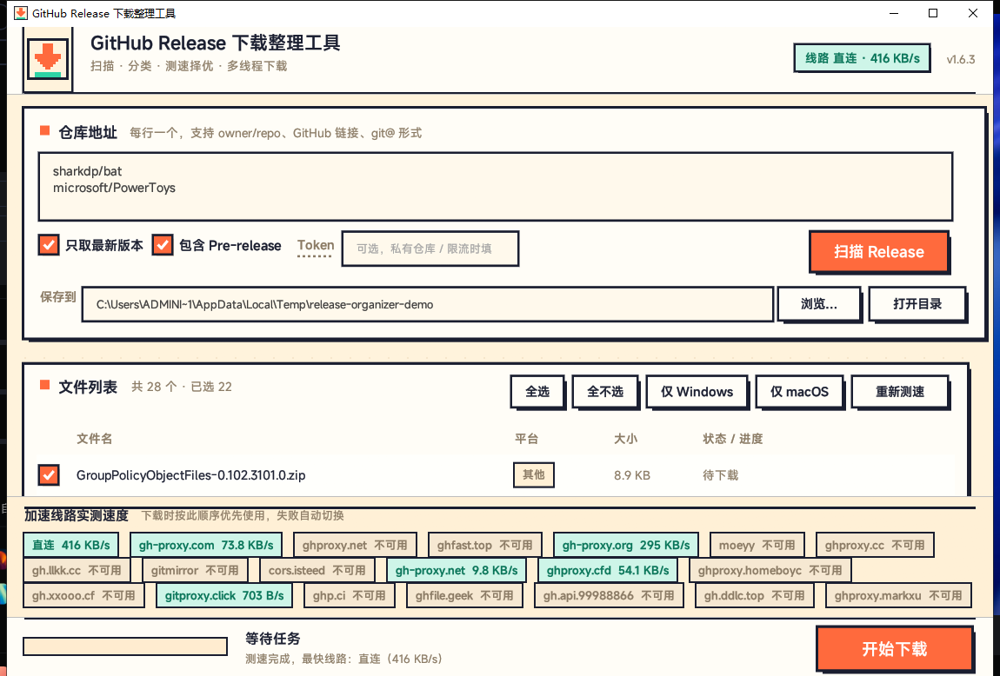
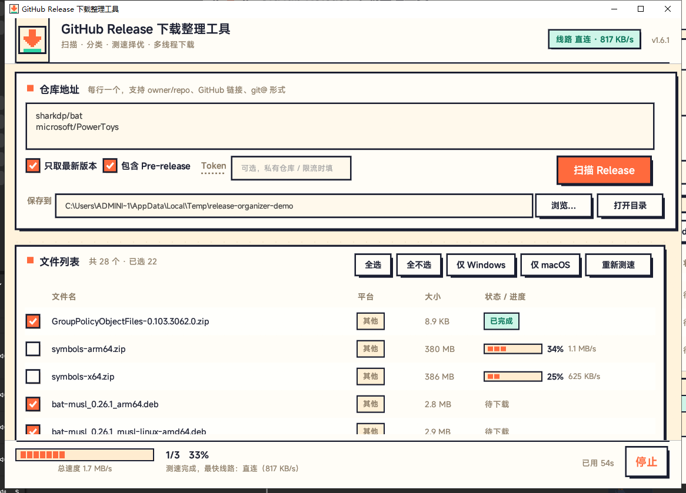
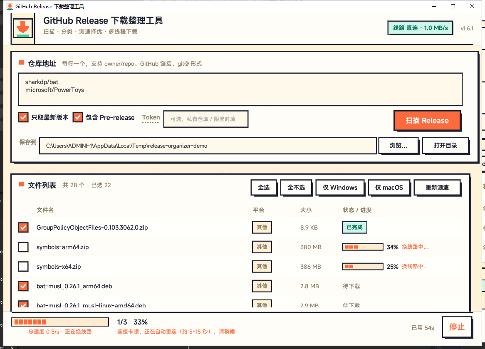
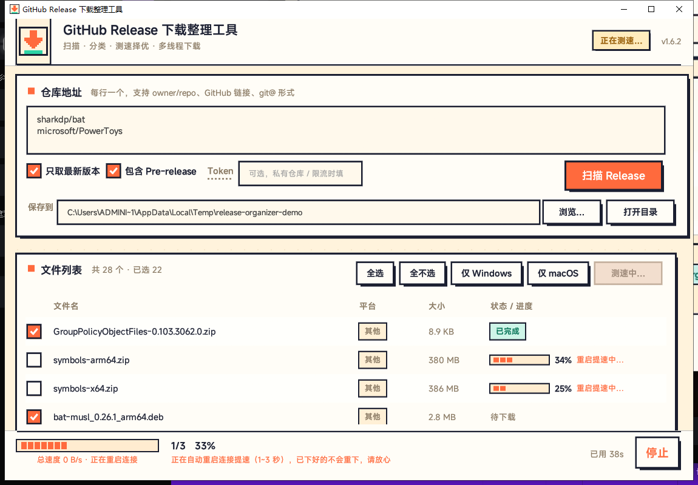
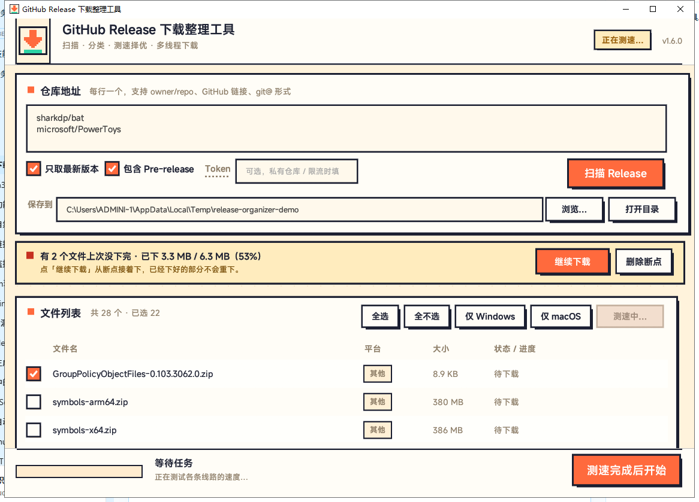
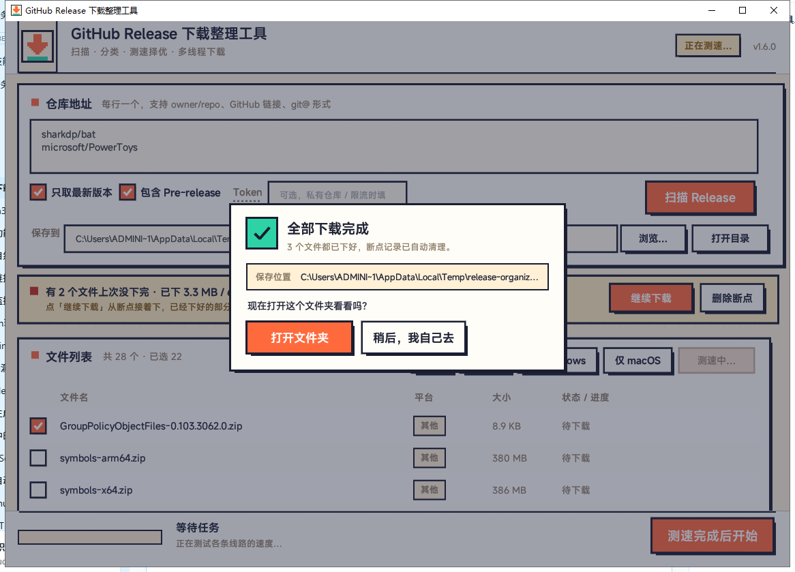
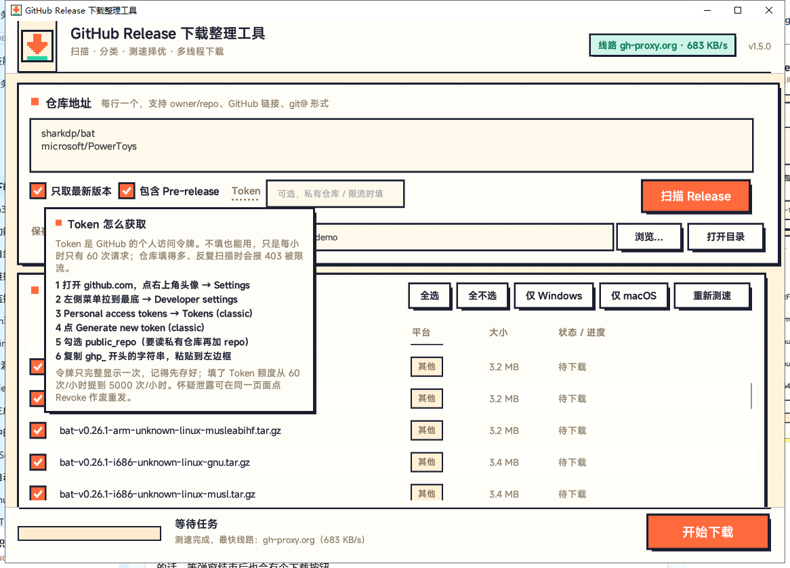
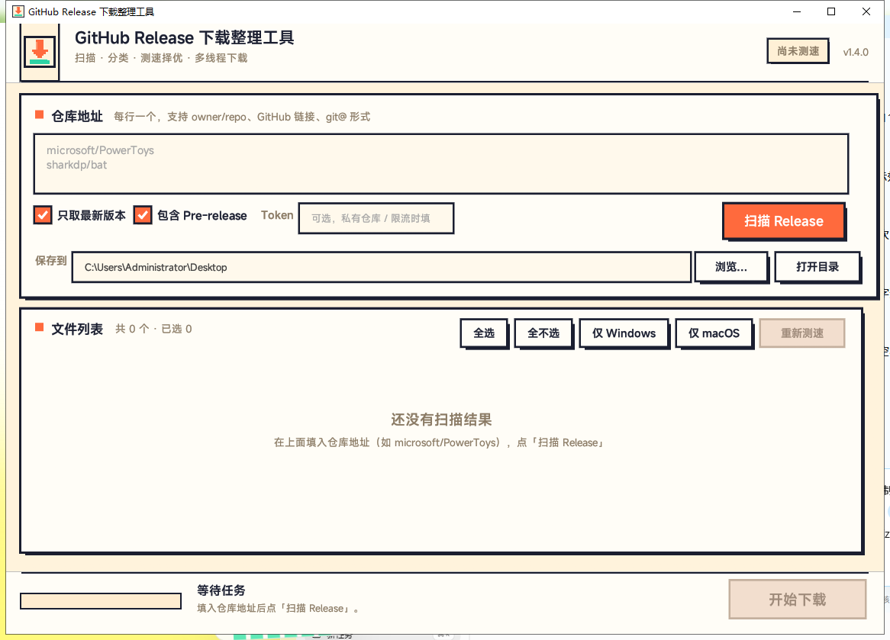
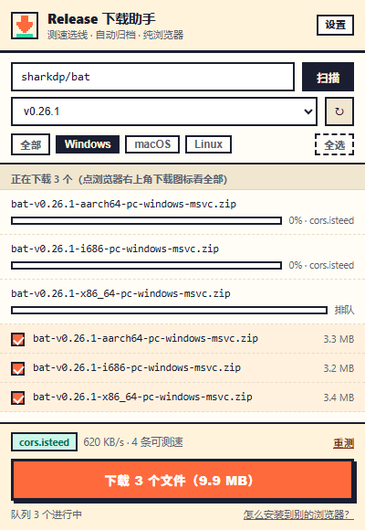
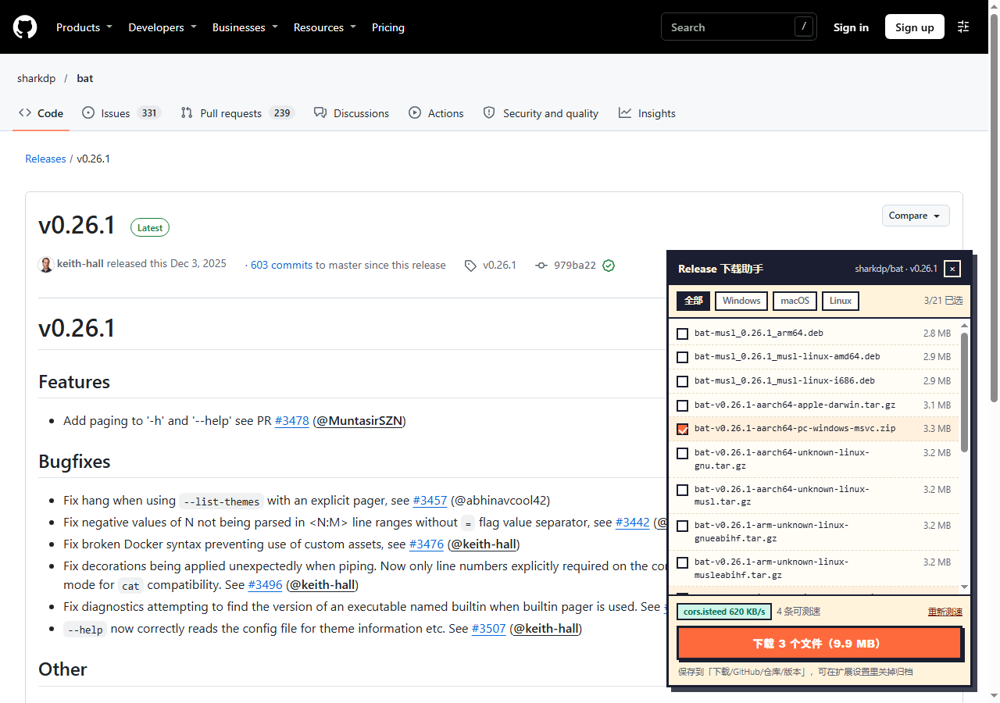

# GitHub 下载整理工具，超极速下载

批量下载多个仓库的 GitHub Release 文件，并按系统与架构自动归档到不同文件夹。免安装单文件程序，像素风界面，支持 **Windows / macOS**（另有[浏览器扩展](#浏览器扩展不装软件也能用)版）。


> 不用装 exe，解压加载即可用 → [下载扩展](#下载)


从浏览器拓展程序内下载，实测速度可破50M每秒


## 下载

| 用途 | 文件 |
| --- | --- |
| Windows（推荐，免安装） | [`GitHub-Release-Downloader-Desktop-v1.6.8.exe`](https://github.com/ziyuanhuishequ/release-downloader/releases/latest/download/GitHub-Release-Downloader-Desktop-v1.6.8.exe) |
| macOS（Intel + Apple 芯片通用） | [`GitHub-Release-Downloader-macOS-v1.6.8-universal.zip`](https://github.com/ziyuanhuishequ/release-downloader/releases/latest/download/GitHub-Release-Downloader-macOS-v1.6.8-universal.zip) |
| Chrome / Edge / Brave / 360 / QQ | [`GitHub-Release-Downloader-Ext-v1.4.6-chrome.zip`](https://github.com/ziyuanhuishequ/release-downloader/releases/latest/download/GitHub-Release-Downloader-Ext-v1.4.6-chrome.zip) |
| Firefox | [`GitHub-Release-Downloader-Ext-v1.4.6-firefox.zip`](https://github.com/ziyuanhuishequ/release-downloader/releases/latest/download/GitHub-Release-Downloader-Ext-v1.4.6-firefox.zip) |

上面几个文件都在 [**最新 Release**](https://github.com/ziyuanhuishequ/release-downloader/releases/latest) 的 Assets 里，
点文件名即可直接下载；同一个 Release 里还有 `GitHub-Release-Downloader-Source-v1.6.8.zip`（Rust 源码）。
扩展的每个历史版本另有单独 Release（如
[ext-v1.4.6](https://github.com/ziyuanhuishequ/release-downloader/releases/tag/ext-v1.4.6)）。

**装扩展**：解压到固定目录（别放临时目录，删了扩展就失效）→ `chrome://extensions`
（Edge 是 `edge://extensions`）→ 右上角开启「开发者模式」→「加载已解压的扩展程序」→ 选解压出来的文件夹。
扩展是「加载已解压」安装，**不会自动更新**：换新版后覆盖解压，再到扩展页点「重新加载」。

**装 macOS 版**：解压 zip 得到 `GitHubReleaseDownloader.app`，拖进「应用程序」文件夹即可，不用装任何运行时
（包内是 arm64 + x86_64 的通用二进制，Intel 与 Apple 芯片都能跑）。

> 没做 Apple 开发者签名/公证，第一次打开会被 Gatekeeper 拦住。任选一种方式放行：
>
> - 在「应用程序」里**右键 → 打开** → 再点「打开」；
> - 或执行一次 `xattr -dr com.apple.quarantine /Applications/GitHubReleaseDownloader.app`。
>
> 只影响首次启动，之后双击即可。

## 它解决什么问题

想收集某个软件的全平台安装包，官方 Release 页要一一下载，文件名还混在一起；下几个仓库就更乱。这个工具把「扫描 → 勾选 → 批量下载 → 自动分文件夹」串成一步。

## 功能

- **国内免魔法直连 GitHub**（浏览器扩展）：勾上「GitHub 国内访问」，不用梯子、不改 hosts，
  仓库页 / Releases / Issues / 代码树都能正常浏览
- **下载走加速通道，速度很快**（浏览器扩展）：点文件名就被接管，走 20 条线路池 + 多线程分片，
  线路慢了 5.5 秒自动换下一条；实测同一文件 30 KB/s → 200–300 KB/s
- **多仓库批量扫描**：一行一个 `owner/repo`，一次扫完所有仓库的 Release
- **只取最新版**：可过滤掉历史版本，也可手动点选需要的那几个文件
- **自动归档**：按 `仓库/系统/` 建子文件夹，Windows / macOS / Linux 各归各位
- **多连接分片下载**：大文件自动切成 4 / 6 / 8 段并发，失败自动回退单连接
- **卡顿自愈**：10 秒没进展的连接自动断开重连，比同伴慢一大截的分片主动踢掉换线路，
  界面会写明「正在换线路，约 5~15 秒恢复」，不用人工干预
- **自动「暂停→继续」提速**：整体速度掉到本次峰值的 45% 以下时，所有连接一起断开重连，
  效果等同于手动点「停止」再「开始」，通常 1~3 秒恢复且速度翻几倍（全程最多 5 次，间隔 ≥ 25 秒）
- **断点续传**：中断后分片保留，下次启动在列表上方提示「有 N 个文件没下完」，一键接着下
- **实时总速度**：底部进度条下方显示所有任务加起来的速度，掉到 0 会变红提示
- **动态线路池**：内置 20 条镜像，启动后从仓库拉 `routes.json`（12 小时一次，拉不到就用本地缓存/内置表），
  新增或下线镜像只改这个文件，用户端不用更新软件；点「20 条线路」标签可展开看每条线路的实测速度与历史成功率，
  点任意一条即可固定使用；exe 同目录放 `routes.txt` 还能再加自己的私有线路
- **504 快速换线**：网关超时/5xx 立刻换下一条线路并拉黑，不再在死线路上反复重试 3 次；
  整轮网络类失败会等 2 秒自动重试一次
- **Token 支持**：未登录 GitHub API 每小时限 60 次，填 Token 可提升额度
- **完成提醒**：全部下完后弹窗询问是否直接打开保存文件夹
- **检测更新**：顶栏有 GitHub 图标 + 「检测更新」，点一下就知道有没有新版本，有新版本直接跳下载页
- **像素风界面**：全部控件手绘，无第三方 UI 库皮肤
- **浏览器扩展版**：不想装软件时，在 Release 页勾选即下（见下方「浏览器扩展」一节）

## 界面

| 20 条线路的实测速度（点右上角标签展开） | 下载中（进度条下是总速度） |
| --- | --- |
|  |  |

| 换线路时的提示 | 自动重启连接提速 |
| --- | --- |
|  |  |

| 断点续传提示 | 下载完成提醒 |
| --- | --- |
|  |  |

| 字段悬停说明 | 空状态 |
| --- | --- |
|  |  |

## 使用

1. 按上面的[下载表](#下载)拿 `GitHub-Release-Downloader-Desktop-v1.6.8.exe`，双击运行，无需安装
2. 在仓库框里填入 `owner/repo`，多个用换行分隔
3. 点「扫描 Release」，列表出来后勾选需要的文件
4. 选好保存目录，点「开始下载」

Pre-release 过滤、Token 获取方式等细节，界面上把鼠标停在对应字段约 0.3 秒会浮出说明。

## 浏览器扩展（不装软件也能用）
> ### 浏览器扩展：国内免魔法直连 GitHub，而且下载很快
>
> **① 免魔法直连。** 勾上扩展里的「GitHub 国内访问」开关，**不用梯子、不用改 hosts、不用装代理软件**，
> `github.com` 的仓库页、Releases、Issues、代码树都能正常打开。
>
> **② 下载不经过镜像，所以快。** 页面浏览走镜像，**下载请求一律走「20 条加速线路池 + 多线程分片」**，
> 线路一慢 5.5 秒就自动换下一条。同一个文件实测从 **30 KB/s 提升到 50M/S **，大文件差距更明显。
>

同一个工具还有个纯浏览器版：在 GitHub Release 页面右下角直接勾选下载，不用装 exe。
支持 Chrome / Edge / Brave / 360 / QQ 等 Chromium 内核浏览器，也能打包成 Firefox 版。

**核心就两条，也是日常最常用的：**

- **国内免魔法直连 GitHub**：打开「GitHub 国内访问」开关，不用梯子、不用代理软件、不用改 hosts，
  `github.com` 的仓库页、Releases、Issues、代码树都能正常打开（开关细节见下方 v1.4.6 说明）。
- **下载很快**：**只有「打开网页」的请求走镜像，下载请求完全不经过镜像** ——
  一律走「20 条加速线路池 + 多线程分片」，线路慢了 5.5 秒自动换下一条（最多换 6 条）。
  实测同一个文件：直连 30 KB/s → 走加速通道 200–300 KB/s；大文件差距更明显。

| 工具栏弹窗 | Release 页注入的面板 |
| --- | --- |
|  |  |

安装：下载 `GitHub-Release-Downloader-Ext-v1.4.6-chrome.zip` → 解压到固定目录 →
打开 `chrome://extensions` → 开启「开发者模式」→「加载已解压的扩展程序」→ 选该目录。

扩展 v1.3.0 起支持多线程分片（同一条最快线路上并发）、实时速度与剩余时间、
慢速自动「暂停→继续」、手动换线路；每个任务都能暂停/继续（分片任务保留已下数据，接着下不重来）；
文件列表用「未下载 / 下载中 / 已暂停 / 已下载」四种角标区分，还能一键「只看未下载」；
线路面板可展开看全部线路的实测速度与健康度，点一下固定使用；设置页同样有「检测更新」和线路池更新。

扩展 v1.4.6 新增「GitHub 国内访问」开关：没有梯子时打开它，浏览器访问 `github.com` 的页面会
自动转到可用的整站镜像（当前实测可用 `gh-proxy.at9.net`、`cors.isteed.cc`），仓库页、Releases、
代码树、Issues 都能正常浏览。**只有「打开网页」这一种请求会被重定向，下载请求完全不经过镜像**，
仍旧走线路池 + 分片续传，速度和断点续传都不受影响。

在镜像页上点 Release 文件也是同一个结果：扩展会把这次下载**接管过来，自动切回快速通道**
（线路池 + 分片 + 失败换线），不会再顺着镜像那条单连接慢速直连下。中键点开也一样会被接管；
万一脚本没拦住，后台也会把镜像下载取消掉再改走快速通道。镜像池写在
`routes.json` 的 `sites` 字段里，2 小时自动更新、开开关时强制刷新，当前镜像失效会在后台
自动切到下一个可用的；全都不通时保持直连。

### 镜像不可靠，这个功能会不会哪天就废了

会——如果只靠别人的公益镜像的话。能代理**整站网页**的镜像本来就极少（绝大多数 gh-proxy
只代文件、不代页面），实测长期可用的通常只有一两台，被限流（429）或直接关站都很常见。
这是服务本身的性质，任何插件都改变不了。所以 v1.4.6 在这个功能之外又做了三件事：

1. **API 和网页彻底解耦。** `api.github.com` 在国内同样被污染。扩展现在给 API 也配了多条通路
   （直连 → gh-proxy.org → gh-proxy.com → ghproxy.net，谁先通用谁，并记住上次成功的那条）。
   结果是：**哪怕 github.com 一个镜像都打不开，点扩展图标粘贴 `owner/repo`，照样能列出
   所有 Release 并下载**。这条路径完全不依赖网页。
2. **镜像失效自动换线。** 后台定期复核正在用的镜像，挂了就静默换一台，下次打开页面不会白屏；
   开开关也不再等探测——有上次用过的镜像时 100ms 内就生效。
3. **可以自建。** 设置页「更稳的做法：自建加速节点」里内置了一段 Cloudflare Worker 代码，
   复制 → 部署 → 把地址填进「自定义镜像」即可。免费额度每天 10 万次请求，个人下载绰绰有余，
   不受任何人的限流影响。这是目前最可控的方案（`*.workers.dev` 在国内不稳，建议绑定自己的域名）。

用法、设置、与桌面版的差别见 [extension/README.md](extension/README.md)。

## 编译

环境：Rust stable（建议 1.75+）、Windows 下需要 MSVC 链接器（安装 Visual Studio Build Tools 并勾选「使用 C++ 的桌面开发」）。

```bash
cd rust
cargo build --release
```

产物为 `rust/target/release/release-organizer.exe`，约 4.7 MB。`Cargo.toml` 已配置体积优化（`opt-level="z"` + `lto` + `panic="abort"` + `strip`）。

macOS：同一份源码直接 `cargo build --release` 即可（`build.rs` 只在 Windows 上链接 `.res` 图标资源）。
官方包要的是「一个 .app 同时支持两种芯片」，这步在真 Mac 上做比较省事，仓库里配了 CI：
`.github/workflows/macos.yml` 会分别编译 `aarch64-apple-darwin` 与 `x86_64-apple-darwin`，
用 `lipo` 合成通用二进制，套上 `.app`（图标由 `rust/assets/icon-1024.png` 经 `sips`/`iconutil` 生成）并 ad-hoc 签名，
最后打出 `GitHub-Release-Downloader-macOS-v<版本>-universal.zip`。推 `v*` 标签或在 Actions 里手动触发即可，
指定 `tag` 输入框会把 zip 自动挂到对应 Release。

### 改版本号

四处要同步修改，否则 exe 属性和窗口显示会对不上：

1. `rust/Cargo.toml` → `version`
2. `rust/src/main.rs` → `const APP_VERSION`
3. `rust/src/main.rs` → `const USER_AGENT`
4. `rust/assets/make_icon.py` → `version_blob(ver=...)`，然后 `python rust/assets/make_icon.py` 重新生成图标资源

### 图标资源

`assets/icon.rgba` 在编译期由 `include_bytes!` 编进程序当窗口图标，`assets/icon.res` 由 `build.rs` 链接进 exe 当文件图标，这两个文件必须存在。它们都由 `make_icon.py` 从一张 16×16 字符画生成。

> 注意：界面左上角的图标按 48×48 绘制（16 的整数倍）。改成非整数倍尺寸（例如 42）会让最近邻采样丢行丢列，图标看起来会变形。

## 目录结构

```
├─ rust/
│  ├─ Cargo.toml           依赖与 release 编译配置
│  ├─ Cargo.lock
│  ├─ build.rs             把 assets/icon.res 链接进 exe
│  ├─ src/main.rs          全部逻辑，单文件
│  └─ assets/              图标资源与生成脚本
├─ tools/
│  ├─ rangesrv.py          本地 Range 测试服务器（带限速），验证断点续传
│  ├─ slowsrv.py           只让第一个分片请求变慢，验证「慢分片自动换连接」
│  ├─ boost_srv.py         前 N 个请求慢、之后的请求全速，验证「自动重启提速」
│  └─ err_srv.py           全 504 / 全 404 / 前 N 个 504，验证换线与自动重试
├─ packaging/macos/
│  └─ Info.plist           .app 的元信息模板（版本号由 CI 替换）
├─ .github/workflows/
│  └─ macos.yml            在真 Mac 上编译 mac 通用包并挂到 Release
├─ screenshots/            界面截图
└─ 使用说明.txt             面向使用者的完整说明
```

字体从系统加载：Windows 用 MiSans → 等线 → 黑体 → 雅黑，macOS 用苹方 → 冬青黑 → 黑体，因此仓库不包含字体文件。

## 「下着下着不动了」是怎么处理的

大文件下到一半停住十几秒、然后猛跳一截，绝大多数不是程序问题，而是连接层面：

1. **GitHub 对单条连接限速**。8 条连接里某一条被压到几十 KB/s，它负责那一段几乎不动；
   其余 7 段下完后只剩它一个在爬，整体进度看起来就「卡住」了。
2. **半开连接**：链路断了但对端不报错，客户端只能等超时。
3. 磁盘写入被占用（杀毒软件扫描正在下载的安装包时最明显）。

代码里对应的五道防线：

| 机制 | 位置 | 作用 |
| --- | --- | --- |
| 下载 agent 不设整体超时，只设 `timeout_read(15s)` | `dl_agent()` | 旧版用 `timeout(45s)` 是「整个请求」的时限，100MB 在慢速下 45 秒必被强杀重连，这是卡顿的主因 |
| 单连接 10 秒内涨幅 < 48KB → 断开重连 | `download_segmented` 读循环 | 处理完全停滞 |
| 每 1.5 秒采样各分片速度，慢于同伴 1/3 就断开换线路 | `download_segmented` 等待循环 | 处理「慢但没死」的拖后腿分片；只剩最后一段时按绝对速度判断 |
| 整体速度连续两轮低于峰值 45% → 全体重连（自动「暂停→继续」） | `download_segmented` 等待循环 + `boost` 代际计数 | 处理「整条线路都变慢」，重新握手落到更快的 CDN 节点 |
| 504/502/503 → 立刻换线路并拉黑，连撞 3 条就停 | `route_dead()` + `dead_routes` | 处理「镜像站整站挂了」。以前不分青红皂白重试 3 次，8 条线路就是 24 次 504，用户要白等好几分钟 |

全局重连的实现：主线程把 `boost: AtomicU64` 加一，各分片线程在读循环里比对建连时记下的代际，
一变就主动断开，然后从磁盘上的 `.partN` 长度续传。主动重启**不累计失败次数**，冷却 25 秒、
全程最多 5 次、剩余不足 8MB 时不再触发，避免来回折腾。

所有中断都从断点续传，不重下已经拿到的字节（`.partN` 是 append 写）。
状态写进 `FileProg.note`（只放 `switch` / `boost` 标记，文案由界面映射），
界面在状态列显示「换线路中…」或「重启提速中…」，底部状态行给出「正常现象、要等多久、请放心」的说明。

实测（20MB 文件、本地模拟一条连接被限速到 18KB/s）：改造前 144 秒，改造后 4 秒，md5 一致。
自动提速实测（`tools/boost_srv.py`，前 8 个请求 40KB/s、之后的请求全速）：23.7 秒完成，
服务端日志可见 25.9 秒时全体重连、新连接直接跑满，md5 一致；不重连需 62 秒。

504 处理实测（`tools/err_srv.py`）：

| 场景 | 请求数 | 结果 |
| --- | --- | --- |
| 单线路全 504（1MB） | 2（旧版 3） | 0.8 秒给出「所有线路都超时（HTTP 504）」 |
| 3 条线路全 504 | 6（旧版 9） | 2.4 秒 |
| 20 条线路全 504 | 12（旧版 60） | 6.4 秒，含一次自动重试 |
| 20MB 大文件全 504 | 26（旧版 88） | 2 秒放弃分片 + 单连接兜底 |
| 前 3 条 504、第 4 条正常（20MB） | 26 | 6.4 秒下完，md5 一致 |
| 一次抖动（第 1 个请求 504） | 2 | 自动重试后成功，md5 一致 |

## 断点续传的文件格式

断点保存在 `保存目录/仓库名/平台/` 下：

- 单连接：`<文件名>.part`
- 多连接：`<文件名>.part0` … `<文件名>.partN`
- 元信息：`<文件名>.part.meta`（key=value 纯文本）

```
v=1
repo=microsoft/PowerToys
folder=Windows
asset=PowerToysUserSetup-0.85.1-x64.exe
target=PowerToysUserSetup-0.85.1-x64.exe
size=268435456
url=https://github.com/.../PowerToysUserSetup-0.85.1-x64.exe
```

校验规则：

- `size` 与实际文件不符（换了版本）→ 断点作废
- 已下字节大于总大小 → 断点作废
- 已下字节达到总大小且 `.part` 存在 → 直接改名收工
- 合并前核对各分片总长必须等于 `size`，不等则报错并保留断点，不会拼出坏文件

设计上有一条约定：取消或分片失败时**不删除分片**；只有服务器不支持 Range 时才清理，因为要整体回退单连接。

## 线路池：远端可更新，内置 20 条兜底

线路优先来自仓库根目录的 [`routes.json`](routes.json)：程序启动后异步拉取（12 小时内只拉一次），
拉不到就依次退到本地缓存（`%LOCALAPPDATA%\GitHubReleaseDownloader\routes.pool.json`）、最后退到 `ROUTE_LIST` 内置表——
所以镜像站集体换域名时，只改 `routes.json` 并推一次，所有用户下次启动就自动用上新线路，不用发版本。

缓存和线路健康度统计写在 `%LOCALAPPDATA%\GitHubReleaseDownloader\`（`routes.pool.json`、`routes.stats.json`），
**不会出现在 exe 旁边**——桌面和下载文件夹保持干净；老版本散落在 exe 同目录的那两个文件，
启动时会自动挪进去并删掉原文件。

`routes.json` 格式（`prefix` 必须以 `/` 结尾，空串表示直连）：

```json
{
  "version": 1,
  "updated": "2026-11-26",
  "routes": [
    { "name": "直连", "prefix": "" },
    { "name": "gh-proxy.com", "prefix": "https://gh-proxy.com/" }
  ]
}
```

界面右上角「20 条线路」点开可看每条的实测速度与历史成功率（跨文件累计），点一条即可固定使用。
免费镜像经常整站挂掉或开始限流，所以宁可多放备胎：测速只有真拉到数据的才排到前面，挂掉的自动沉底，
不影响正常下载。

想再加线路不用改代码——`routes.txt` 放到 exe 同目录，一行一条：

```
# 注释行以 # 开头
我的线路|https://gh.example.com/
https://another.example.com/
```

`名称|前缀` 用竖线分隔，只写前缀也行；末尾斜杠会自动补。测速时与内置线路一起测，能不能用由测速决定。
`GitHub下载整理工具.exe --routes` 可以打印当前生效的线路表（便于确认 routes.txt 有没有被读到）。

状态码处理见 `route_dead()`：`403/404/408/410/425/429/500/502/503/504/520~524` 视为「这条线路自己不可用」。
4xx 立即换线；5xx 在同一条线路上补试 1 次（隔 0.7 秒）再换；换掉的线路写进本轮 `dead_routes` 黑名单，
多文件下载时后面的文件直接跳过它。连续 3 条线路都是线路级失败就停止尝试——线路表 20 条，
不设这个闸门的话，全网挂掉时用户要盯着转好几分钟。

## 调试用的隐藏参数

```bash
release-organizer.exe --dl <url> <size> <保存目录> [文件名]   # 不启动界面，只下载单个 URL
release-organizer.exe --pending <保存目录>                   # 列出未完成的下载
release-organizer.exe --routes                               # 打印生效的线路表（含线路池与 routes.txt）
release-organizer.exe --pool                                 # 强制更新一次线路池并打印结果
release-organizer.exe --fontcheck                            # 字体加载自检
release-organizer.exe --pick                                 # 目录选择对话框自检
release-organizer.exe --selftest                             # 内置自测
```

环境变量：`RO_DEMO=1` 演示模式、`RO_OUTDIR=<路径>` 强制保存目录、`RO_DIALOG=1` 启动即弹出完成提醒、`RO_TIP=latest|pre|token` 强制显示某个悬停说明、`RO_FAKE=1|stall|boost` 伪造进行中的下载进度（用于截界面图，`stall` 是「正在换线路」、`boost` 是「正在重启提速」的样子）、`RO_DL_ROUTES="https://a/,https://b/"` 给 `--dl` 指定多条线路（测换线/黑名单用）。

验证断点续传：

```bash
python tools/rangesrv.py <某个大文件> 18777 260000
release-organizer.exe --dl http://127.0.0.1:18777/big.bin <大小> <输出目录> big.bin
# 中途结束进程，再执行同一条命令，应从断点继续
```

验证「慢分片自动换连接」（第 1 个分段请求被限速到 18KB/s，其余正常，应几秒内自愈）：

```bash
python tools/slowsrv.py <某个大文件> 18781 2000000 18000
release-organizer.exe --dl http://127.0.0.1:18781/big.bin <大小> <输出目录> big.bin
```

验证「自动暂停→继续提速」（前 8 个请求每个 40KB/s，客户端发现总速上不去会全体重连，
之后的请求按 2.4MB/s 全速发；服务端日志应出现第二批请求）：

```bash
python tools/boost_srv.py <某个 20MB 文件> 18783 40000 2400000 8
release-organizer.exe --dl http://127.0.0.1:18783/big.bin 20971520 <输出目录> big.bin
```

验证「504 快速换线 / 自动重试」（服务端全返回 504，应在几秒内失败并给出中文原因；
`flaky:1` 是第一个请求 504、之后正常，用于验证自动重试）：

```bash
python tools/err_srv.py <某个文件> 18785 all
release-organizer.exe --dl http://127.0.0.1:18785/big.bin <大小> <输出目录> big.bin

python tools/err_srv.py <某个文件> 18786 flaky:1
release-organizer.exe --dl http://127.0.0.1:18786/big.bin <大小> <输出目录> big.bin
```

## 说明

- 仅支持 Windows，目录选择对话框、打开文件夹、图标资源都依赖 Win32 API
- 字体依赖系统已安装的 MiSans，未安装时观感会变，功能不受影响
- 下载开始时界面右下角会显示一个约 8 秒自动关闭的推广卡片。不需要的话，注释掉 `main.rs` 里 `draw_promo` 的调用即可
- 界面上的浮层卡片（推广卡、悬停说明、完成提醒）是手绘控件，不支持键盘 Tab 聚焦

## 许可证

[Apache License 2.0](LICENSE)
