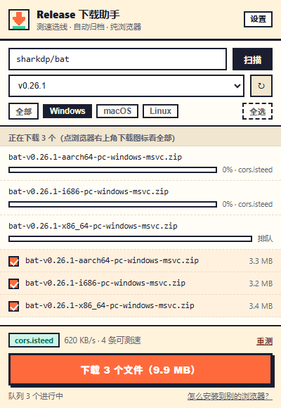
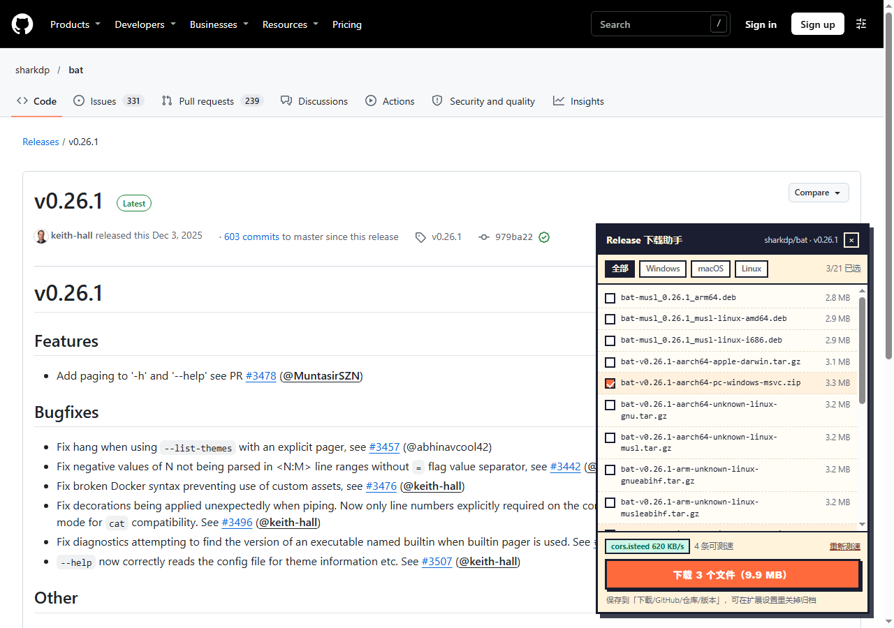

# GitHub Release 下载助手 · 浏览器扩展

桌面版 exe 的浏览器版：不装任何软件，在 GitHub 的 Release 页面或扩展弹窗里勾选文件，
自动测速选最快镜像、按 `仓库/版本/` 归档下载。

支持 Chrome / Edge / Brave / Arc / 360 / QQ 等 Chromium 内核浏览器（Manifest V3），
同一份代码也能以 Firefox 版打包运行。





## 安装

### Chrome / Edge / Brave / 360 / QQ

1. 从 [Releases](https://github.com/ziyuanhuishequ/release-downloader/releases) 下载
   `GitHub-Release-Downloader-Ext-v1.0.0-chrome.zip`
2. 解压到一个**固定位置**（别放临时目录，目录删了扩展就失效）
3. 打开 `chrome://extensions`（Edge 是 `edge://extensions`），右上角打开「开发者模式」
4. 点「加载已解压的扩展程序」，选中解压出来的文件夹
5. 工具栏出现珊瑚色图标，装好即可用

> 想钉在工具栏：点拼图图标 → 找到「GitHub Release 下载助手」→ 点图钉。

### Firefox

1. 下载 `GitHub-Release-Downloader-Ext-v1.0.0-firefox.zip` 并解压
2. 地址栏打开 `about:debugging#/runtime/this-firefox`
3. 点「临时载入附加组件」，选中解压目录里的 `manifest.json`

Firefox 的临时载入在重启后失效。要长期使用，建议用 Chrome / Edge，或自行签名后安装。

## 用法

**方式一：在 Release 页面直接下**

打开任意 `https://github.com/<owner>/<repo>/releases` 页面，右下角出现悬浮按钮，
点开就是该版本的资源列表：按 Windows / macOS / Linux 筛选，勾选后点「下载 N 个文件」。

**方式二：从扩展图标进来**

点工具栏图标，填 `owner/repo`（例如 `sharkdp/bat`），点「扫描」，
下拉框可切到历史版本，勾选后点下载。

两种方式都支持：
- 全选 / 按平台筛选
- 自动测速 20 条加速线路，优先走最快的那条
- 下载前先探 256KB 校验（防镜像返回网页），不对自动换线
- 断线、5xx 自动降级到备用线路重试，坏线路冷却 3 分钟
- 按 `下载/GitHub/仓库名/版本号/文件名` 归档，可选关掉

## 设置

点弹窗右上角「设置」：

| 项 | 说明 |
| --- | --- |
| GitHub Token | 匿名接口 60 次/小时，填 Token 提到 5000 次/小时，也能读私有仓库 |
| 并发数 | 同时下载几个文件，默认 3 |
| 归档目录 | 默认 `GitHub/{owner}/{repo}/{tag}/`，可改成 `GitHub/{repo}/{tag}/` 或平铺 |
| 自动测速 | 关掉后按内置顺序依次尝试 |
| 线路 | 一行一条自定义镜像，格式 `名称\|https://前缀/` |
| 完成通知 | 全部下完弹系统通知 |

## 常见问题

**提示「测速受限」**：部分镜像没开 CORS，浏览器读不到响应内容，所以测不出速度。
这不影响下载——下载走的是浏览器下载器，不受跨域限制，扩展仍会按顺序自动尝试。

**提示「文件不存在（404）」**：两条不同线路都返回 404，说明版本号或文件名已失效
（比如资产被作者重命名过）。回 Release 页刷新一下列表再试。

**「请求太频繁」/ 403**：GitHub 匿名 API 每小时 60 次，去设置里填 Token。

**下下来的不是文件而是网页**：镜像挂了会返回 HTML 错误页。扩展在下载前会先探一段
校验内容类型，发现是 HTML 就换线，正常不会把错误页存成文件。遇到就重新下。

**下载目录里出现 `xxx (1).zip`**：浏览器对同名文件默认加序号。要覆盖同名，在
`chrome://settings/downloads` 里把「下载前询问每个文件的保存位置」关掉后行为会更稳定，
或先删掉旧文件。

## 开发

```
extension/
├── manifest.json          MV3 清单
├── icons/                 16/32/48/128 图标（make_icons.py 生成）
├── src/
│   ├── common.js          线路表、URL 拼接、平台识别、格式化
│   ├── bg.js              Service Worker：GitHub API、测速、下载队列、失败换线
│   ├── content.js         Release 页注入面板（Shadow DOM，样式完全隔离）
│   ├── popup.html/css/js  工具栏弹窗
│   └── options.*          设置页
├── screenshots/           README 用截图
├── make_icons.py          改配色后重新生成图标
└── build.py               打包 chrome/firefox zip + 免解压目录
```

改完代码在 `chrome://extensions` 点扩展卡片上的「刷新」即可生效（内容脚本需刷新页面）。

打包：

```bash
cd extension
python build.py
```

产物在仓库根目录：`GitHub-Release-Downloader-Ext-v<版本>-chrome.zip` 与 `-firefox.zip`，
以及解压好的 `浏览器扩展/` 目录（可直接「加载已解压的扩展程序」）。
`build.py` 会按 `manifest.json` 的 `version` 命名，改版本号只改这一处。

## 与桌面版的差别

| | 桌面版 exe | 浏览器扩展 |
| --- | --- | --- |
| 安装 | 下载即用 | 需要手动加载一次 |
| 多分片下载 | 4/6/8 段并发 | 交给浏览器单连接 |
| 断点续传 | 支持，`.partN` 保留 | 依赖浏览器自身 |
| 跨域限制 | 无 | 测速受镜像 CORS 影响 |
| 平台 | Windows | 所有 Chromium 浏览器 + Firefox |

日常想快点、想断点续传用 exe；在别人的电脑上、或只想随手拉一个文件，用扩展。
